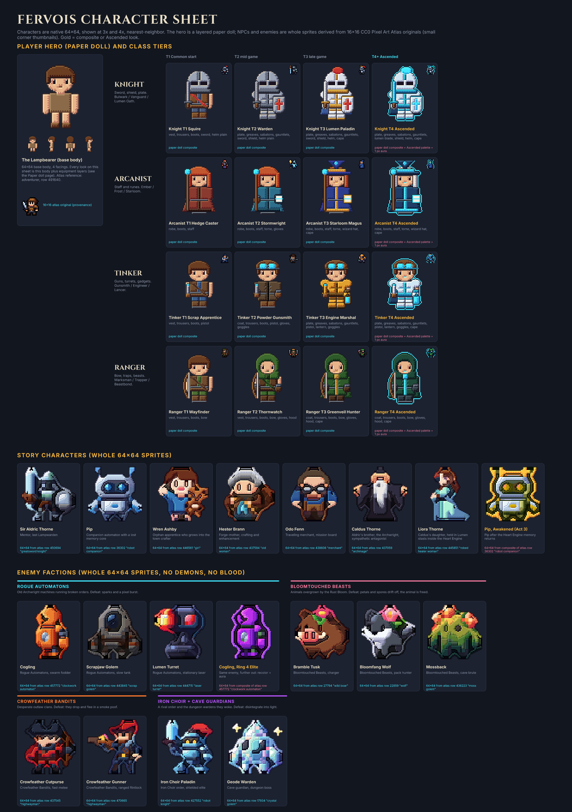
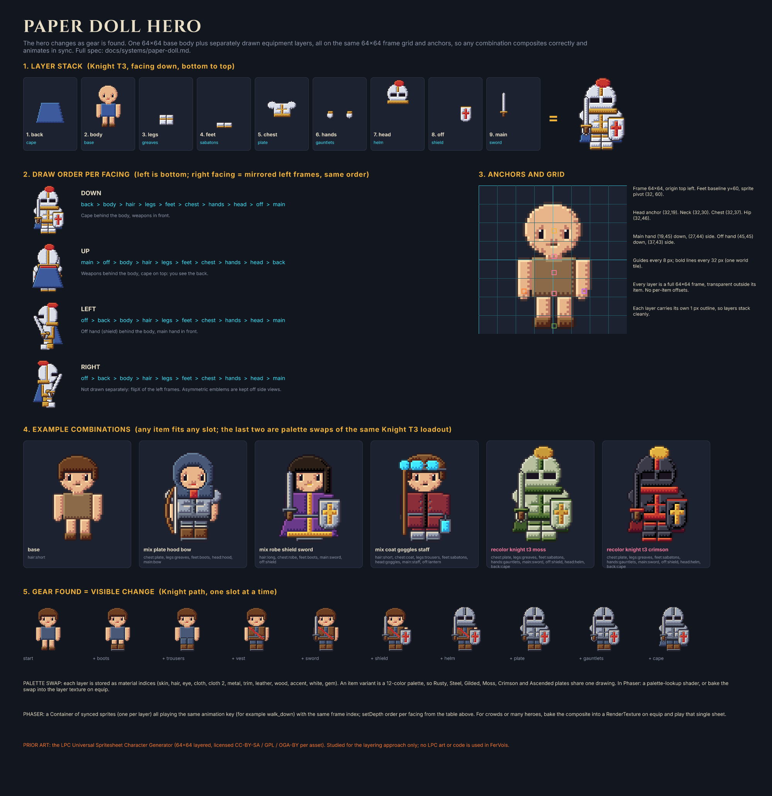

# FerVois

A top-down action RPG in the spirit of Diablo's loop (explore, clear, loot, grow) without the demons and the gore. Medieval knights, mages, rangers and tinkers, with the odd laser rifle and clockwork turret. The overworld is generated as you push into the Fade, and the further you travel from Hollowmere, the harder it gets. Nothing has a level cap.

**Status:** concept and design only. No game code yet (by design: prototype comes next, see the PRD).





## What is here
| Path | What |
|---|---|
| [docs/PRD.md](docs/PRD.md) | Product requirements: vision, engine pick, core loop, world, combat, progression, MVP, milestones, risks, open questions |
| [docs/story.md](docs/story.md) | Main story, cast, emotional beats, side-quest framework and 12 side quests |
| [docs/systems/](docs/systems/) | Detail docs: world generation, combat, progression math, loot and crafting, skill trees, save data, paper-doll hero |
| [docs/references.md](docs/references.md) | Every pixel art / gamedev resource we collected, license, what we use it for |
| [docs/figcraft.md](docs/figcraft.md) | How the FigCraft design file is built and exported |
| `figcraft/fervois.figcraft` | FigCraft design file (Cover, Character Sheet, Style Guide, Paper doll, FX, World Buildings) |
| `figcraft/exports/` | PNG exports of every frame |
| `art/` | 64 x 64 character art: paper-doll hero layers (`art/doll/`), NPC and enemy sprites (`art/x64/`) derived from 16 x 16 CC0 Pixel Art Atlas originals (`art/originals-16/`), FX renders, building renders, and the scripts that make them. See [art/SOURCES.md](art/SOURCES.md) |

## Paper doll test

A small Phaser 4 scene walks the hero on a 32 x 32 tile field and swaps clothing while the walk keeps playing. Sheets live in `art/doll/hero/`. Palettes in the panel are Steel, Gilded, Moss, and Crimson.

```bash
cd prototype/doll-test
npm install
npm run dev
```

Walk with WASD or the arrow keys. Attack with Space, a click, or the Attack button. On a phone, drag the stick or tap the ground. The turntable checkbox shows the same loadout walking in four directions.

To bake the sheets again (original code drawings, no outside art):

```bash
python3 -m venv .venv
.venv/bin/pip install -r art/requirements.txt
.venv/bin/python art/doll/sheets.py
```

## Design tools
Designs live in [FigCraft](https://getartcraft.com/apps/figcraft) (open source, github.com/storytold/figcraft). Not Figma.
