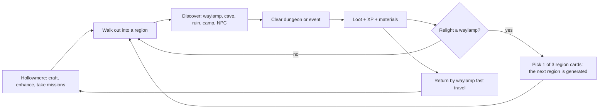
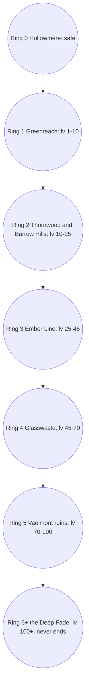

# FerVois: Product Requirements (v0.1)

Owner: Mike Carlo (Ethereal Knight). Status: concept, pre-prototype. Last updated Nov 8, 2026.

Detail docs: [story](story.md), [world generation](systems/world-gen.md), [combat](systems/combat.md), [progression math](systems/progression.md), [loot and crafting](systems/loot-crafting.md), [skill trees](systems/skill-trees.md), [save data](systems/save-data.md), [references](references.md).

---

## 1. Vision

FerVois is a top-down action RPG with the Diablo loop: walk out, find something, fight it, take its stuff, get stronger, walk further. It drops the satanic setting and the blood. Enemies are rogue machines, overgrown beasts, outlaw clans and a misguided knightly order. When they fall they burst into sparks, petals, smoke or light.

The world is medieval (keeps, forges, taverns, plate armor, longbows) with occasional high-tech pops left behind by a lost order of engineers: laser lances, flintlock-looking pulse pistols, clockwork turrets, a lighthouse that shines into the sky.

"Create the game as you move along" is the hook. The map past your village is lost in the Fade. Each time you relight a waylamp, you pick what the next region becomes from three region cards, and the game generates it from a seed. The world is literally made by where you go and what you choose. See section 7 and open question Q1.

### Pillars
1. **Every walk pays.** Ten minutes of play always yields at least one upgrade, one discovery, or one story beat.
2. **The edge of the map is the difficulty slider.** Distance from Hollowmere sets enemy level. You choose how hard it gets by choosing how far you go.
3. **Nothing caps.** Levels, gear enhancement and skill ranks go up forever. Growth slows, but it never stops.
4. **People worth fighting for.** A small cast (Aldric, Pip, Wren, Hester, Odo, Caldus) with real arcs, so the loot has a reason.
5. **Medieval first, tech as spice.** One tech accent per sprite, in Lumen Cyan. A laser is a relic, not a default weapon.

### Not doing
- Demons, hell, occult symbols, skulls as decoration, blood, gore, dismemberment.
- PvP at launch. Online trading at launch.
- Seamless open world. Loading screens between regions and dungeons are fine (Mike, Nov 8).

## 2. Target player
- Primary: adults and teens who loved Diablo II/III, Torchlight, Grim Dawn, Path of Exile and Hades, but want something cleaner to play with their kids or on a lunch break.
- Secondary: pixel-art and cozy-RPG players who want a bit more combat.
- Rating target: ESRB E10+ / PEGI 7 to 12. Cartoon fantasy violence, no blood.
- Sessions: 15 to 45 minutes. A dungeon is 5 to 12 minutes. A full region is about 30 minutes.

## 3. Platform and engine

### Platform
Web-first, like Mike's other games: desktop browser with keyboard + mouse and gamepad, static build deployed to GitHub Pages and Fabric through GitHub Actions. Mobile browser (twin-stick touch) is a stretch goal after the prototype proves the fun. A desktop wrapper (Tauri or Electron) for Steam can come later from the same build.

### Engine options

| | Phaser 4 (default) | Godot 4 web export | Excalibur.js | PixiJS v8 + our own systems |
|---|---|---|---|---|
| Mike's history | Phaser 3 on Paginated Bear, Angry Data, Data Shuffle | None | None | None |
| Many entities | SpriteGPULayer: one draw call for huge sprite counts. Logic cost is ours (pool + spatial hash) | Fast native nodes, good with many enemies | OK, smaller ecosystem | Fastest raw rendering, but every system is ours |
| Big tilemaps | TilemapGPULayer: whole layer as one quad, up to 4096 x 4096 tiles | TileMapLayer, solid | Basic tilemap | Need a plugin or our own |
| Web build size | ~1.2 MB min JS | WASM build tens of MB, slow first load on phones; threads need COOP/COEP headers, so we would ship single-threaded | Small | Small |
| Physics | Arcade (AABB, fast) plus Matter if needed | Full 2D physics | Built in, simple | None |
| Save data | IndexedDB from JS, easy | `user://` maps to IndexedDB on web, fine | Our own | Our own |
| Tooling | Vite, TypeScript, Playwright, our CI and deploy actions already work | New editor, GDScript, new CI | Vite/TS | Vite/TS |
| Agent support | Phaser 4 ships 28 agent skill files; awesome-gamedev-agent-skills has phaser-core and phaser-arcade-physics | Many godot-* skills | Few | pixijs-rendering skill |

### Does an ARPG strain Phaser?
Honest answer: rendering is not the problem anymore, game logic is.
- **Hundreds of enemies:** Phaser 4's GPU layers draw huge sprite counts cheaply. The cost is AI, collision and damage numbers on the CPU. We handle it with object pools, a uniform spatial hash for collision instead of Arcade's all-pairs groups, simple steering (flow field toward the player per room), and only simulating entities inside the active chunks around the camera.
- **Big procedural overworld:** a region is 256 x 256 tiles (4096 x 4096 px at 16 px tiles). Generation runs in a Web Worker behind a loading screen, then the region is drawn as TilemapGPULayer layers. Because Mike is fine with loading screens, we do not need seamless streaming, which was the hardest part. Regions and dungeons are separate scenes.
- **Uncapped stats:** numbers past 1e15 need care in any engine. We store big values as doubles with display suffixes, and plan a switch to log-space or break_infinity.js for deep Ascension (see systems/progression.md). Engine-neutral.
- **Save data:** small. We save the seed plus deltas (relit lamps, cleared dungeons, opened chests, inventory), not tile arrays. IndexedDB, versioned JSON. Engine-neutral.

### Recommendation
**Phaser 4 (4.2.x) + TypeScript + Vite**, with a thin ECS for enemies and projectiles (bitECS or plain typed arrays) and Web Workers for world generation. It keeps Mike's toolchain, deploys the same way as his other games, and Phaser 4's GPU sprite and tilemap layers remove the two classic web ARPG bottlenecks. Godot 4 is the fallback only if we go desktop/Steam-first, where its web-export weight stops mattering.

It is close enough to prove with a spike before committing:

### Spike test (1 to 2 days, before the prototype)
Build a throwaway Phaser 4 scene with:
1. One generated 256 x 256 tile region (noise biomes, 3 layers) built in a Web Worker, shown after a loading screen.
2. 500 enemies with steering toward the player, a spatial hash for collision, 40 live projectiles, floating damage numbers, and pixelfx hit sparks.
3. Save and load of 2,000 region deltas plus a 300-item inventory to IndexedDB.

Pass bar: 60 fps on Mike's laptop and 45+ fps on a mid phone (iPhone 12 / Pixel 6 class) with 500 enemies; region generation under 1.5 s; save under 50 ms; tab memory under 400 MB. If it fails, rerun the same spike on PixiJS v8 + bitECS. If both fail on mobile, ship desktop web first and revisit Godot for a native build.

## 4. Core loop

Moment to moment: move, dodge, hit, read enemy tells, pop a skill, grab drops. Minute to minute: clear a cave, open the chest, compare items. Hour to hour: relight lamps, push one ring further, finish a story act, respec a tree.

## 5. World structure

- **Hollowmere (Ring 0):** the home village and hub. Safe. Forge, workshop, mission board, stash, the first waylamp. Grows as the story moves (Wren's workshop, new vendors, rebuilt houses).
- **Overworld regions:** each region is a 256 x 256 tile map generated from `worldSeed + regionCoord + cardChoice`. Entering one shows a short loading screen ("The Fade parts..."). A region has 1 waylamp, 2 to 4 dungeon entrances, 3 to 6 points of interest, roads, and 1 handcrafted story or side-quest location when the story needs it.
- **Dungeons and caves:** separate scenes entered through doors, cave mouths and keep gates. Room-and-corridor generation (BSP plus hand-made room templates), 3 to 12 rooms, must be cleared to open the reward vault. Types: caves, barrows, Archwright vaults (tech pop), bandit forts, Iron Choir chapels (renamed "halls" to avoid church imagery).
- **The Fade:** the grey edge past explored regions. Walking into it is how you discover new regions.

### Distance-based difficulty rings

Region level = `10 * d^1.15` where `d` is region distance in steps from Hollowmere (Chebyshev distance on the region grid), plus or minus 2 for flavor. Ring 6+ has no end: every step out adds levels and an Ascension band (see progression). Elites further out get visual ring markers (style guide).

## 6. Procedural generation (overview)
Full detail in [systems/world-gen.md](systems/world-gen.md).
- Deterministic: same seed, same world. Saves store seed plus deltas.
- Layers: elevation and moisture noise pick biomes; roads are A* between waylamp, dungeon entrances and points of interest; scatter (trees, rocks, ruins) by Poisson disc; encounters placed by a budget that grows with region level.
- Region cards (the "create as you go" part): when you relight a waylamp you draw three cards. Each names a biome, a faction and a modifier, such as "Thornwood / Crowfeather camps / Foggy nights (stealth bonus)". The chosen card seeds the next region in the direction you are facing. Story regions force a card when an act needs it.
- Dungeon generation: BSP rooms plus a library of hand-made rooms (shrines, traps, set pieces). Boss room always last; reward vault behind it.

## 7. "Create the game as you move along": interpretation
Three readings, from safest to wildest:
- **A. Procedural world that expands as you explore** (recommended base). The map does not exist until you reach it.
- **B. Player-authored regions** (recommended on top of A). Region cards let the player pick what comes next: biome, faction, modifier. Later: placing your own waystones, naming regions, choosing a dungeon's theme from found "charts".
- **C. AI-generated content** (future). An LLM writes side-quest text and NPC dialogue for generated regions, inside templates. Big upside, real risk (tone, cost, moderation). Prototype off.
Open question Q1 asks Mike which mix he meant.

## 8. Combat
Full detail in [systems/combat.md](systems/combat.md).
- Real-time, top-down three-quarter view. WASD or left stick to move, mouse or right stick to aim. Left click basic attack, right click secondary, 1 to 4 skills, Space dodge roll (0.25 s i-frames), Q potion, E interact.
- Aim-based (not click-to-move) because guns, lasers and bows need aim, and it plays better on gamepad.
- Game feel: 60 to 90 ms hit-stop on heavy hits, small screen shake, white flash, knockback, pixelfx impact sparks. Enemies telegraph with a 0.4 to 0.8 s wind-up and a ground marker.
- Damage types: Physical, Fire, Frost, Lightning, Lumen (tech/holy light), Nature. Enemies have resistances by faction.
- Defeat effects instead of blood: automatons spark and fall apart into bolts, beasts shed petals and run away freed, bandits poof into smoke and flee, Iron Choir dissolve into light. Players are "knocked out" and wake at the last waylamp.

## 9. Enemies (non-demonic factions)

| Faction | Fantasy | Examples (character sheet) | Defeat effect |
|---|---|---|---|
| Rogue Automatons | Archwright machines running broken orders | Cogling (swarm), Scrapjaw Golem (tank), Lumen Turret (stationary laser) | sparks, bolts, pixel burst |
| Bloomtouched Beasts | Wildlife overgrown by the glittering Rust Bloom | Bramble Tusk (charger), Bloomfang Wolf (pack), Mossback (cave brute) | petals and spores drift off, the animal is freed |
| Crowfeather Bandits | Outlaw clans, desperate, not evil | Cutpurse (fast melee), Gunner (ranged flintlock) | smoke poof, they flee |
| Iron Choir | Caldus's knightly order, true believers | Choir Paladin (shield elite), later Choir Mech (boss) | disintegrate into light |
| Cave Guardians | Old dungeon wardens woken by the Bloom | Geode Warden (boss) | shatter into crystal |

Each enemy has a role (fodder, tank, ranged, charger, support, elite, boss), 1 to 3 attacks, and an elite version with one extra affix (Shielded, Swift, Splitting, Lumen-charged, Rallying).

## 10. Character creation and customization
- Pick a body type, skin tone, hair style and color, eye color, voice (3 sets), and a starting trinket (story flavor, tiny bonus).
- Pick a starting class (Knight, Arcanist, Tinker, Ranger). You can unlock a second class "Oath" at level 30 (open question Q5).
- Gear changes the look (visible helm, chest, weapon, shield, back). Transmog at Hester's Forge for free once a look is found.
- Dye slots: two per armor piece, from the FerVois palette.

## 11. Stats and leveling
- Core attributes: **Might** (melee damage, armor), **Focus** (spell damage, mana), **Grit** (health, resistances), **Finesse** (crit, attack speed, ranged damage). +5 points per level, plus class growth.
- Pools: Health, Mana (Arcanist), Heat (Tinker: builds as you fire, vent to use), Resolve (Knight: builds when blocking), Focus pips (Ranger).
- Derived: damage, armor, resistances, crit chance, crit damage, attack speed, move speed, cooldown reduction, luck (magic find).
- Uncapped: see section 12.

## 12. Uncapped progression (summary)
Full formulas and examples in [systems/progression.md](systems/progression.md).
- **Levels never cap.** XP to next level: `50 * L^2` up to 100, then `50 * L^2 * 1.01^(L-100)`. Each level: +5 attributes, +1 skill point.
- **Flat stats scale, percent stats saturate.** Crit, dodge, cooldown and resist use rating vs level: `pct = cap * r / (r + k * Lenemy)`. You never hit 100% crit, but more rating always helps.
- **Enemy and gear power grow on the same curve** (`base * 1.07^level`), so a well-geared player feels the same at level 30 and 3,000. The edge comes from enhancement, skills and build choices.
- **Ascension after 100:** each level also gives an Ascension point for infinite boards (+0.5% damage, +1% gold, +0.3% move speed per point, with soft caps on utility).
- **Gear enhancement never caps** (section 15).
- **Rekindle (optional prestige):** reset rings for a permanent Lantern multiplier. Open question Q6.

## 13. Skill trees and specializations
Full node lists in [systems/skill-trees.md](systems/skill-trees.md). Each class has three specialization trees. You put points in any tree; the capstone of one tree locks your specialization identity (you can respec at Hester's for gold).

| Class | Weapons | Specializations | Tech pop |
|---|---|---|---|
| Knight | sword, mace, shield, greatsword | Bulwark (tank, block, taunt), Vanguard (charge, cleave), Lumen Oath (holy-tech light) | Lumen blade, shield emitter |
| Arcanist | staff, wand, tome | Ember (fire), Frost (control), Starloom (arcane + Archwright runes) | rune-cores that orbit you |
| Tinker | pistols, rifles, wrenches, turrets | Gunsmith (guns, crits), Engineer (turrets, drones), Lancer (laser lance, beam) | most of the tech lives here |
| Ranger | bows, crossbows, knives, traps | Marksman (long shots), Trapper (traps, bombs), Beastbond (freed beast companion) | arrow tips, grapple line |

Every tree ends with an **Endless node** that takes unlimited points with diminishing returns (`+bonus * 1/(1+n/25)` per point), so spare points always do something.

## 14. Magic
- Arcanist is the main caster, but every class has 1 to 2 spells from its trees (Knight light, Ranger nature, Tinker "Archwright science").
- Mana regenerates; spells can be **inscribed** with runes found as loot (a rune changes a spell: Fireball + Split rune = 3 small fireballs).
- Spell rank goes up with skill points and with use (each cast gives spell XP; rank has no cap and adds +2% effect per rank with diminishing returns after rank 20).

## 15. Loot, missions, crafting (summary)
Full detail in [systems/loot-crafting.md](systems/loot-crafting.md).
- Rarity: Common (white), Fine (green), Rare (blue), Heroic (violet), Legendary (gold), Relic (cyan, tech-pop uniques). Affixes 0/1/2/4/4+unique/unique.
- Item level from region level. Better rarity odds with Luck and deeper rings.
- **Missions** (Odo's board): contracts that reward targeted gear in a slot you choose, plus materials. Types: Clear, Hunt (named elite), Recover (relic in a dungeon), Escort, Defend (camp), Survey (relight a waylamp in a new region).
- **Crafting** at Hester's Forge (weapons, armor), Wren's Workshop (guns, gadgets, mods) and the Rune Loom (spell runes): Craft from blueprints, Salvage, Reforge (reroll one affix), Socket, Enhance (+N, no cap), Ascend (T3 to T4+ look, Ascension band).
- Enhancement: each +1 adds `10% / (1 + N/20)` to the item's base stats. This sum grows without limit but slower and slower. Cost grows `1.12^N`. No failure chance, no item loss (Mike wants growth, not gambling).

## 16. Story (summary)
Full story bible in [story.md](story.md).
The Lumen Engines once kept FerVois warm and its roads lit. Now they stutter, the Fade swallows the land past the village, and a glittering overgrowth called the Rust Bloom twists animals and wakes the old machines. You are a Lampbearer from Hollowmere, trained by Sir Aldric Thorne, the last Lampwarden, and followed by Pip, a small automaton with no memory. The man draining the land is Caldus Thorne, Aldric's brother, who is keeping his daughter alive inside the Heart Engine. Three acts, about 15 hours, with Aldric's sacrifice at the Ember Line and a final choice about Pip.

## 17. Side quests (summary)
Framework: each region gets 1 handcrafted side quest when one fits, plus 2 to 4 generated "Fade Echoes" from templates. Rewards are permanent: attribute points, skill points, blueprints, companions, town upgrades, looks. Twelve examples in [story.md](story.md#side-quests).

## 18. UI and HUD
- HUD: health and resource orbs (shields, not skulls), skill bar 1 to 4 plus mouse skills, potion count, XP bar, minimap with region ring color, quest tracker (3 lines), damage numbers (Ember Gold crits), boss bar.
- Screens: title (big pixel portrait), character creation, inventory and paper doll, stash, item compare tooltip, skill trees (pan and zoom), Ascension board, crafting stations (one screen each), mission board, world map (regions, rings, Fade), dialogue (portrait + 3 choices max), journal, settings (rebind, colorblind palettes, damage numbers on/off, screen shake slider), save slots.
- Controller first-class on every screen.
- No em dashes in player-facing copy. Clean language. Short tooltips.

## 19. Art direction
- **Base:** 16 x 16 sprites from the CC0 Pixel Art Atlas (1.4M captioned sprites), curated and recolored into the FerVois palette. 1 px dark outline, no anti-aliasing, integer scaling only. Game renders at 480 x 270 and scales 4x on 1080p.
- **Hero:** open question Q4. The atlas has mostly single front or three-quarter frames, and Paginated Bear taught us the player needs four facing directions and more pixels (it used 28 x 32). Proposal: enemies and NPCs stay 16 x 16 atlas sprites (with simple 2-frame bob and squash), the hero is redrawn at 32 x 32 with down, up, left, right walk, idle and attack, using the atlas sprite as the design reference for each gear tier.
- **Medieval + tech-pop rule:** base materials are steel, leather, cloth, wood, stone, brass. Tech accents are Archwright relics in Lumen Cyan (#40E8FF). One tech accent per sprite at most. Tech gets more common the further out you go (Ring 4+ vaults).
- **Tiers:** T1 to T3 are distinct atlas sprites. T4+ "Ascended" keeps the T3 silhouette, rotates warm accents to cyan and adds a 1 px aura (see Character Sheet).
- **Backgrounds:** subtle, low-contrast ground with a light white wash (2 to 4%) so small characters pop (Paginated Bear lesson). Title screen uses a large pixel portrait.
- **Buildings:** towns, keeps, forges and tech outposts rendered with parametric-topdown-pixel-architecture as placeholders and layout studies (atlas licenses to clear before shipping).
- **FX:** pixelfx effects (MIT) recolored to the palette: slash, shield block, laser bolt, muzzle flash, disintegrate, poof, coin drop, level up. No blood effects.

### Reference toolkit
Full notes, licenses and how each one shapes FerVois: [references.md](references.md).

| Resource | License | Role in FerVois | Status |
|---|---|---|---|
| Pixel Art Atlas 1.4M | CC0 | Primary sprite source | Used (all character sheet sprites) |
| mono-pix / fast-pixelizer | MIT | Snap composites and AI sprites to a true grid | Used (all composites snapped) |
| pixelfx | MIT | Combat, spell and defeat FX, sprite sheets | Used (FX page renders) |
| Sprite Fusion pixel-art VFX | MIT | FX reference, MCP for agents | Referenced |
| parametric-topdown-pixel-architecture | MIT code; atlas art needs checking | Town, keep and outpost sprites | Used (World Buildings page) |
| Kenney | CC0 | Gray-box tiles, UI, fonts, audio for the prototype | Referenced (prototype) |
| CraftPix freebies | CraftPix license, not CC0, forbids AI use | Reference only | Referenced, do not ship without a per-pack check |
| awesome-gamedev-agent-skills | Apache-2.0 | Agent skills: procedural-gen, rpg, save-systems, phaser-core | Referenced (load during prototype) |
| Spawn | Platform ToS | Design reference (Places and instances, Savi loop) | Referenced; its rules forbid prototyping there to ship elsewhere |
| Paginated Report Bear | Ours | 4 directions, denser hero, big title portrait, white wash, game-feel checks | Lessons applied |

## 20. Audio direction
- Music: small medieval ensemble (lute, recorder, hurdy-gurdy, frame drum, low strings) with warm synth pads under tech areas. One theme per ring, a Hollowmere theme that grows as the town is rebuilt, a boss motif per faction. Mike's Suno and Data Songs pipeline can make vocal versions for trailers (clean lyrics).
- SFX: chunky, short, readable. Metal clank for automatons, leafy whoosh for Bloom beasts, cork pop for bandit smoke, glassy chime for Lumen. Kenney audio packs (CC0) for the prototype.
- Voice: barks only (3 to 5 lines per NPC), plus Pip's little beeps that turn into words over the story.

## 21. MVP prototype scope (prove the fun before art)
Per Mike's new-game process: gray box first, iterate until it is fun, then lock the style guide.
1. Spike test (section 3).
2. Hollowmere as a tiny hub: forge (enhance), stash, mission board (2 contracts).
3. One generated Ring 1 region and one Ring 2 region behind a loading screen, with region cards on relight.
4. Two dungeons (cave, Archwright vault), 4 to 6 rooms, a boss each (Scrapjaw Prime, Bramble Mother).
5. One class: Knight, 6 skills, one 12-node tree with an Endless node.
6. Five enemies: Cogling, Scrapjaw, Bramble Tusk, Bloomfang Wolf, Crowfeather Cutpurse.
7. Loot: 4 rarities, 8 affixes, 6 slots. Enhancement +N with the real formula.
8. Distance difficulty: Ring 2 feels harder and pays better.
9. Save and load.
10. Placeholder art: Kenney tiles + atlas sprites. pixelfx for hits.
Fun questions to answer: Is the first 10 minutes fun with one class? Does walking further feel like a choice? Does +N enhancement feel good or grindy? Do region cards make players care about the map?

## 22. Milestones
| Milestone | Scope | Target |
|---|---|---|
| M0 Spike | Engine spike, pass bar in section 3 | 1 week |
| M1 Prototype | MVP scope above, playtest with 5 people | +4 weeks |
| M2 Style lock + hero | Style guide final, hero at real scale with 4 directions (process step 4-5) | +2 weeks |
| M3 Vertical slice | Prologue + Act 1, Rings 0 to 2, Knight and Ranger, 4 side quests | +6 weeks |
| M4 Alpha | 4 classes, 12 specs, Rings 0 to 4, Act 2, crafting complete | +8 weeks |
| M5 Beta | Act 3, Ascension, Ring 6+, 12 side quests, audio pass | +8 weeks |
| M6 Launch | Polish, balance, accessibility, web + desktop builds | +4 weeks |

CI deploys every merge to main (Pages + Fabric), like the other games.

## 23. Risks
| Risk | Why it matters | Mitigation |
|---|---|---|
| Atlas sprites are single frames | No walk cycles or 4 directions in the dataset | Redraw the hero at 32 x 32 (Q4); 2-frame bob for others; pixelfx acting for attacks |
| Atlas style varies | 1.4M sprites from many generators | Curate per faction, recolor to palette, snap composites with fast-pixelizer, style review page in FigCraft |
| Procedural sameness | Generated regions blur together | Region cards, hand-made room library, 1 handcrafted site per region, strong landmarks |
| Infinite-scaling balance | Power creep or a wall | Same exponential base for enemies and gear, rating-vs-level for percent stats, balance sheet tests to level 10,000 |
| Web performance | 500 enemies + FX on phones | Spike test, GPU layers, pools, chunk simulation, desktop-first fallback |
| Scope | ARPGs are huge | MVP is one class and two regions; acts ship in slices |
| Licenses | CraftPix is not CC0; ptpa atlas art unclear; Spawn ToS | Ship only CC0/MIT assets; log every asset in art/SOURCES.md |
| Tone | "No satanic vibe, no blood" across generated content | Content rules in the style guide, generated text in templates only |

## 24. Open questions for Mike
1. **Q1 "Create the game as you move along":** procedural world (A), plus region cards where you pick what comes next (B), plus AI-written side quests later (C). Which mix did you mean?
2. **Q2 Solo or co-op?** Co-op (2 to 4 players) is a big engine and server decision. Solo first, co-op later?
3. **Q3 Platform:** desktop web first with gamepad, mobile later. OK, or must phones be day one?
4. **Q4 Hero size:** keep 16 x 16 for everything, or redraw the hero at 32 x 32 with four directions (recommended)?
5. **Q5 Multiclass:** one class per character, or unlock a second class "Oath" at level 30?
6. **Q6 Prestige:** do you want Rekindle (reset rings for a permanent multiplier), or only endless Ascension?
7. **Q7 Death penalty:** wake at the last waylamp with no loss (current), or drop some gold/materials you can recover?
8. **Q8 Tech amount:** guns and lasers as rare relics (current), or a full Tinker class from level 1 (also current)? Is that the right balance of medieval vs tech?
9. **Q9 Ending:** Pip's choice is bittersweet but hopeful. OK, or keep it lighter?
10. **Q10 Engine:** happy with Phaser 4 pending the spike, or want to try Godot side by side?
11. **Q11 Name styling:** "FerVois" (capital V) everywhere, including the logo?
