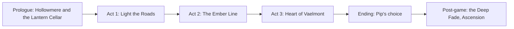

# FerVois: Story Bible (v0.1)

Clean, warm, a little funny, sad in two or three places. No demons, no gore. Villains have reasons.

## Pitch
Three hundred years ago the Archwrights buried the Lumen Engines under FerVois. The Engines warmed the soil, powered the waylamps along every road and held back the Fade, a grey nothing where the land is forgotten. Now the Engines stutter. The Fade has swallowed everything past Hollowmere, a glittering overgrowth called the Rust Bloom twists the animals, and the old machines wake up running orders nobody remembers. You are a Lampbearer from Hollowmere. Sir Aldric Thorne, the last of the Lampwarden knights, hands you his lantern and teaches you to relight the roads. A small automaton named Pip follows you out of a cave and will not leave. The further you walk, the more you find out who is draining the light, and why: Caldus Thorne, Aldric's brother, is keeping his daughter alive inside the Heart Engine, and every region he drains buys her another day.

## The lantern (why the world builds as you go)
A Lampbearer's lantern "remembers" land. When you relight a waylamp, the Fade in front of it clears, and the lantern offers three memories of what was there (the region cards). The one you choose becomes real. This is the diegetic reason for procedural generation and for player choice.

## Cast

| Character | Role | Sprite (character sheet) | Arc |
|---|---|---|---|
| **The Lampbearer** (player) | Village kid turned knight, mage, tinker or ranger | hero_base + class tiers | From follower to the one who carries the light |
| **Sir Aldric Thorne** | Mentor, last Lampwarden. Gruff, kind, bad at cooking | npc_aldric | Teaches you, carries guilt about his brother, gives his light at the Ember Line |
| **Pip** | Small automaton with a blank memory core. Beeps, learns words, steals bread | npc_pip, npc_pip_awake | Learns to speak, discovers he holds a shard of the Heart Engine, makes the final choice |
| **Wren Ashby** | Orphan, 12, tags along, hands always dirty | npc_wren | Becomes Hollowmere's master crafter; finds out what happened to her parents |
| **Hester Brann** | Forge-mother, retired siege engineer, loud laugh | npc_hester | Teaches Wren, reforges her old hammer, says goodbye to Aldric |
| **Odo Fenn** | Traveling merchant with a mule called Duchess and too many stories | npc_odo | Runs the mission board; secretly a former Crowfeather bandit who can broker peace |
| **Caldus Thorne** | The last Archwright, Aldric's younger brother, leads the Iron Choir | npc_caldus | Not evil, out of time. Must choose between his daughter and the world |
| **Liora Thorne** | Caldus's daughter, asleep in Lumen stasis in the Heart Engine | (to design) | Wakes only in the ending |

## Main story

### Prologue: The Lantern Cellar (Ring 0, about 30 minutes)
- A Fade storm hits Hollowmere at night. Aldric pulls you out of a collapsing barn and gives you his spare lantern "for the walk home". Tutorial: move, attack, dodge.
- Next morning, Wren dares you into the Lantern Cellar under the old Lampwarden hall (first dungeon, Coglings). At the bottom, a small automaton is sitting in the dark holding a dead lamp. It follows you home. Wren names it Pip.
- **Beat:** Aldric sees Pip and goes quiet. He knows that make of automaton. He does not say why.

### Act 1: Light the Roads (Rings 1 to 2, about 4 hours)
- Aldric trains you and sends you to relight three waylamps in Greenreach. First region cards. Meet Odo on the road (mission board unlocks). Hester takes you on at the forge (crafting and enhancement unlock).
- Bramble Tusk herds and Bloomfang packs. The Bloom is spreading from the east.
- Boss: Scrapjaw Prime in an Archwright pump-house, still trying to "maintain pressure" by pulling Lumen from the ground.
- **Beat:** In the pump-house you find an Iron Choir order signed "C. Thorne". Aldric admits he has a brother.
- **Beat:** Pip says his first word ("lamp") when you relight the third waylamp. Wren cries and pretends she did not.

### Act 2: The Ember Line (Rings 3 to 4, about 5 hours)
- The road east ends at the Ember Line, a wall of permanent dusk where the Fade presses hardest. Crowfeather bandits hold the bridges because nobody else will. Odo's past comes out; you can make peace or fight through.
- The Iron Choir arrives: knights in brass-and-steel plate with Lumen shields, singing their marching hymn. They are draining waylamps, not destroying them. They believe Caldus is saving FerVois.
- Wren stays in Hollowmere and opens her workshop (Tinker gear, mods).
- Boss: Choir Mech "Cantor" at the Glasswaste causeway.
- **Beat (the big one):** at the Ember Line bridge the Fade surges. Aldric plants his lantern, tells you to run, and holds it open long enough for everyone to cross. He turns to light and his lantern goes out. You carry it home. Hester rings the forge bell for him. Pip will not stop holding the dead lantern.
- After this, Aldric's Letters side quest opens.

### Act 3: Heart of Vaelmont (Ring 5, about 5 hours)
- Vaelmont, the old capital, is a ring of keeps around a crater with the Heart Engine at the bottom. Lots of tech pop: lighthouse beams, rail turrets, Archwright vaults.
- You learn the truth from Caldus's journals: Liora fell ill as a child. Caldus sealed her in Lumen stasis inside the Heart Engine. The Engine was already failing; to keep her alive he started pulling light from every region. The Bloom is leaked Lumen. The rogue automatons are maintenance machines following his reroute orders.
- **Beat:** Pip's memory returns in the Engine room. He was built by Aldric and Caldus together as young men, and his core is the shard Caldus removed from the Engine to make room for Liora. Pip is the missing piece.
- Boss: Caldus in the Heart chamber. He does not want to fight. Phase 1 is the Choir defending him, phase 2 is the Engine itself defending its stasis, phase 3 is a choice, not a fight.

### Ending: Pip's choice
- Pip can return his core to the Engine. The Engine restarts, the Fade starts to pull back, and Liora can wake. Pip shuts down.
- Caldus offers to go in Pip's place, using his own life to power the stasis release. The player chooses who, with Pip's wish shown clearly (he wants to go).
- Either way: Liora wakes. The roads light up. In the epilogue Wren rebuilds Pip from a tiny fragment of his core in her workshop. He wakes up, beeps once, and says your name. (Bittersweet, never hopeless. Open question Q9 in the PRD.)

### Post-game: the Deep Fade
- The Fade pulls back but never ends. Ring 6+ regions keep generating forever with Ascension bands. Pip (rebuilt) and Wren join you again. Endless nemesis: the Hollow Choir, Choir knights who refused to stand down.

## Side quests

### Framework
- **Handcrafted:** 12 written quests below, each tied to a cast member or a place. Each gives a permanent reward.
- **Fade Echoes (generated):** 2 to 4 per region from templates: `trigger + 2 to 5 steps + reward`. Steps come from verbs: go, clear, collect, talk, escort, defend, craft, relight. Rewards scale with region level.
- **Permanent rewards only:** attribute points, skill points, blueprints, companions, town upgrades, transmog looks, waylamp shortcuts. No one-time potions as quest rewards.
- **Journal:** max 3 tracked. Quests remember what you did in generated regions by region id.

### Twelve examples
| # | Quest | Giver / place | What happens | Reward |
|---|---|---|---|---|
| 1 | Ashby Farm | Wren, Ring 2 | Find the Ashby farm in the Fade. Her parents left before the Fade came and wrote her a letter that never arrived. They are alive, running a waylamp further out | Wren's Workshop tier 2; +2 Grit permanently |
| 2 | Hester's Hammer | Hester, Rings 1 to 3 | Gather the pieces of her old siege hammer from three dungeons and reforge it together | Enhancement guidance: +10% enhancement efficiency; hammer transmog |
| 3 | Old Feathers | Odo, Ring 3 | Odo goes back to the Crowfeather clan he left. Talk, duel or bribe your way to a truce | Crowfeather vendor (ranged mods); bandit camps become neutral in Ring 3 |
| 4 | Pip Learns Words | Pip, all rings | Find 6 voice cylinders in Archwright vaults. Each teaches Pip a word and a companion trick (light, fetch, shield, ping loot, revive, sing) | Pip companion skills |
| 5 | The Choir That Sang Wrong | Choir deserter, Ring 4 | Help a young Choir knight who stopped believing get home safely | Tinker Lancer blueprint; Choir armor look |
| 6 | Bramble Mother | Ring 2 grove | A huge Bloomtouched sow guards her piglets. Cleanse her instead of fighting | Ranger Beastbond companion (boar); +1 skill point |
| 7 | The Lighthouse With No Sea | Ring 3 hill | An Archwright lighthouse shines straight up. Fix it room by room (puzzle dungeon) | Starloom rune; fast-travel beacon |
| 8 | Mill of Nine Cogs | Ring 1 village | A windmill automaton forgot how to mill. Find its 9 cogs | Hollowmere bakery: +5% health permanently |
| 9 | Sir Aldric's Letters | Shrines, after Act 2 | Read Aldric's letters to Caldus he never sent. Learn the brothers' history | Aldric's shield look; +3 Might; changes one line in the finale |
| 10 | The Smallest Knight | Hollowmere kid, any time | A 9-year-old wants to be a knight. Train him in 4 short lessons | Valor trinket; he shows up armored in the epilogue |
| 11 | Geode Heart | Cave chain, Ring 4 | Three linked caves end at the Geode Warden | Socket gems; Geode Warden pet look |
| 12 | Lantern Festival | Hollowmere, after Act 1 | Relight every Ring 1 waylamp in one night and come home for the festival | Festival cosmetics; +1 Ascension point per year played |
