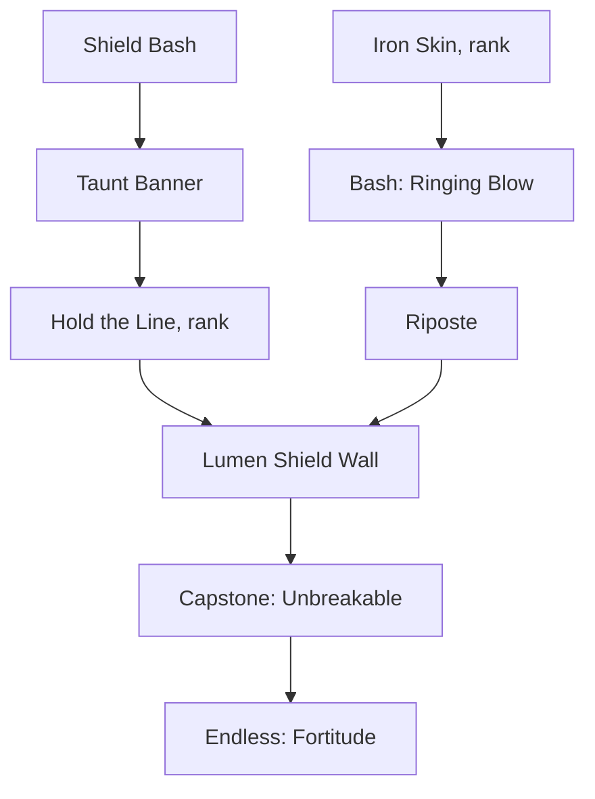

# Skill trees

Each class has 3 trees. Points can go anywhere. Nodes unlock in rows: row 2 needs 5 points in the tree, row 3 needs 10, row 4 needs 20, capstone 30. Taking a capstone sets your specialization title. Every tree ends with an Endless node. Respec at Hester's Forge for gold (cheap early, scales with level).

Node types: **Active** (a skill for the bar), **Rank** (+effect per point, no cap), **Modifier** (changes an active), **Keystone** (big tradeoff), **Endless** (unlimited points, diminishing).

## Knight (sword, shield, plate)
**Bulwark** (tank)
1. Shield Bash (active), Iron Skin (rank: +armor)
2. Taunt Banner (active), Bash: Ringing Blow (mod: stun)
3. Hold the Line (rank: block chance rating), Riposte (mod: perfect block counters)
4. Lumen Shield Wall (active: frontal barrier, tech pop)
5. Capstone: Unbreakable (keystone: cannot be knocked back, -10% move speed)
6. Endless: Fortitude (+health)

**Vanguard** (aggression)
1. Cleave (active), Momentum (rank: +attack speed after moving)
2. Charge (active), Cleave: Wide Arc (mod)
3. Heavy Hand (rank: +stagger), Leap Slam (active)
4. Battle Cry (active: party buff)
5. Capstone: Warpath (keystone: every 3rd hit is a heavy hit, no shield block)
6. Endless: Edge (+physical damage)

**Lumen Oath** (holy-tech light)
1. Lumen Blade (active: sword becomes a light blade for 6 s), Radiance (rank: +lumen damage)
2. Smite (active), Mending Light (active: small heal)
3. Blade: Overcharge (mod: final hit releases a beam), Aura of the Waylamp (rank: regen aura)
4. Judgment Pillar (active: pillar from the sky)
5. Capstone: Last Lampwarden (keystone: when knocked out, revive once per dungeon at 40% health)
6. Endless: Brilliance (+lumen damage)

## Arcanist (staff, runes)
**Ember**: Fireball, Kindle (rank), Flame Wall, Fireball: Split (mod), Combustion (rank: burn damage), Meteor, capstone Wildfire (burns spread on defeat), Endless: Heat.
**Frost**: Frost Bolt, Rime (rank), Frost Nova, Ice Lance, Shatter (mod: frozen targets take crits), Blizzard, capstone Winter's Patience (slower casts, all frost hits freeze), Endless: Chill.
**Starloom** (arcane + Archwright runes): Arcane Missiles, Rune Orbit (active: 3 rune-cores orbit you, tech pop), Blink, Loom (rank: rune power), Starfall, Gravity Well, capstone Unwritten (runes slot into every spell), Endless: Weave.

## Tinker (guns, turrets, gadgets)
**Gunsmith**: Pistol Shot (basic), Steady Hands (rank: crit rating), Fan the Hammer, Scattershot, Heat Sink (mod: vent heat for damage), Deadeye (rank), capstone Six-Gun Saint (every 6th shot crits and ricochets), Endless: Caliber.
**Engineer**: Deploy Turret, Wrench (melee, repairs), Drone Buddy, Turret: Twin Barrel (mod), Overclock (rank), Shield Emitter, capstone Workshop Army (+2 turret limit, turrets cost Heat), Endless: Rivets.
**Lancer**: Laser Lance (beam, the big tech pop), Focus Lens (rank: beam damage), Arc Dash, Lance: Prism (mod: beam splits), Capacitor (rank), Orbital Ping, capstone Lighthouse (stand still to channel a widening beam), Endless: Wattage.

## Ranger (bow, traps, beasts)
**Marksman**: Aimed Shot, Eagle Eye (rank: crit damage), Volley, Pierce (mod), Windrunner (rank: move speed after shots), Rain of Arrows, capstone One Breath (long draw, huge single shot), Endless: Fletching.
**Trapper**: Snare Trap, Caltrops, Powder Bomb, Trap: Bloom Seed (mod: roots), Tripwire (rank), Grapple Line (active, tech pop), capstone Hunter's Garden (traps re-arm once), Endless: Craft.
**Beastbond**: Call Companion (freed Bloomtouched beast), Pack Bond (rank), Command: Charge, Companion: Thick Hide (mod), Twin Bond (second companion), Howl, capstone One Pack (you and companions share buffs), Endless: Kinship.

## Sketch: Knight Bulwark

